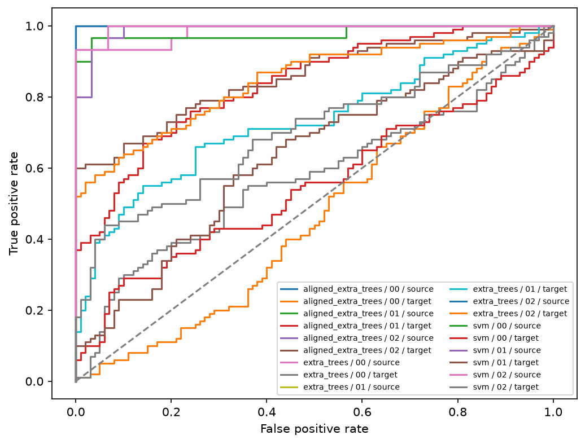
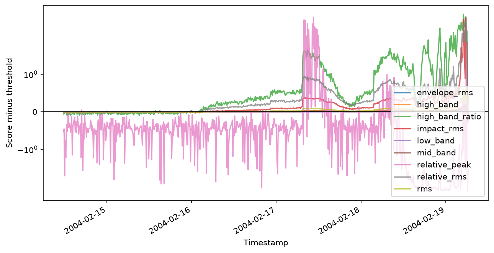
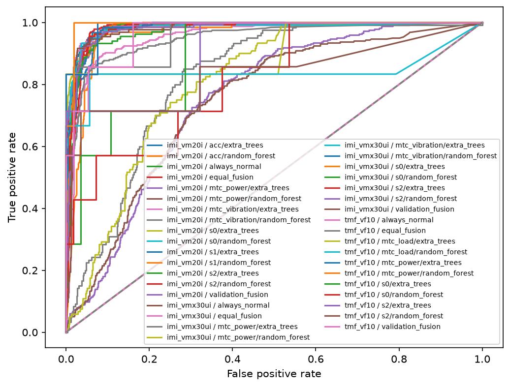

# CrossSense AI
### Modular industrial anomaly detection

**Review presentation · November 24, 2026**

Monitor fan acoustics, bearing vibration, and CNC cutting conditions through one Streamlit application. Each machine uses a detector and evaluation protocol tailored to its recordings.

---

## 1. System architecture

| Input | Feature extraction | Detector output |
|---|---|---|
| Fan WAV | Log-spaced frequency-band statistics | Section-specific anomaly score and decision |
| IMS snapshot | Vibration amplitude, shape, and frequency features | Channel health score and persistent alarm trend |
| MSM sensor CSV | Time-aligned cutting-interval statistics | Power, vibration, and weighted anomaly scores |

The training commands save fitted models, thresholds, held-out predictions, comparison CSVs, and figures. The dashboard applies the same features to the supplied recording or interval.

---

## 2. Fan · MIMII DUE

- 4,209 WAVs across three sections. Train on source and available target normal recordings.
- Fit a separate model per section. Calibrate the threshold on a separate source-normal split before testing.
- Compare nearest-neighbor distance and shrinkage covariance. Report source and target performance per section.
- Covariance reached mean ROC-AUC of approximately **0.64 source / 0.63 target**. Mean F1 was approximately **0.19 / 0.20**.
- The original pooled Autoencoder reached mean section ROC-AUC of **0.60 source / 0.59 target** on the archived predictions. The new detector still misses many anomalies at its calibrated operating point.

**Improvement experiment:** Spectral Extra Trees reached **82.8% source / 61.3% target accuracy** and **65.6% / 57.3% recall**, using a held-out source split and all target test clips. The original covariance detector achieved **51.1% / 51.3% accuracy** on the same clips. The source development split includes both normal and anomaly labels during fitting.

**Speaker note:** ROC-AUC measures score ranking over all operating points. A single threshold changes precision and recall. Compare the operating point against realistic alarm costs before calling it deployable.

---

## 3. Bearing · NASA IMS

- Use test 2, channel 1, at 20 kHz. The run has 984 timestamped snapshots.
- Fit the first 20% and calibrate on the next 10%. Score the remaining 689 snapshots in time order.
- Covariance and Isolation Forest both flagged all 99 final-window proxy snapshots. Each flagged about 69% of the full scored period.
- Three consecutive threshold crossings produce a persistent alarm. True onset is unlabeled, so this experiment cannot establish early-warning lead time or a false-positive rate.

The low-frequency vibration detector flagged **97 of 99** late-life proxy snapshots and **40.2%** of all scored snapshots. This lowers the alarm burden compared with the original 69% while missing two late snapshots.

**Speaker note:** Point to the increasing anomaly margin near the end and explain how the persistence rule responds to consecutive snapshots.

---

## 4. CNC · MSM Milling

- Processed all 69 runs and 2,575 annotated intervals across three configurations. The binary benchmark uses 2,398 stable or abnormal cutting intervals. The 177 tool-defect intervals remain in the feature table.
- Compare Random Forest and Extra Trees per available sensor. Use five run-disjoint test folds. Choose thresholds and fusion weights using training runs only.
- The table shows representative held-out detectors. The industrial power model covered six of the seven abnormal intervals.

| Machine | Detector | Accuracy | Recall |
|---|---|---:|---:|
| imi_vm20i | Microphone S1 Random Forest | 95.5% | 92.0% |
| imi_vmx30ui | Microphone S2 Random Forest | 95.8% | 91.7% |
| tmf_vf10 | Controller power Random Forest | 94.9% | 83.3% |

**Speaker note:** The industrial fusion detected four of seven anomalous intervals. A classifier that always predicts normal would obtain 88.9% accuracy there and miss all seven. The benchmark evaluates new runs within each machine configuration. The same sensors are not available on all three machines.

---

## 5. Live demonstration

1. Launch the Streamlit app and show the three machine pages.
2. Choose a section 00 fan development clip. Show the waveform, spectrogram, model score, and thresholded status.
3. Select a bearing snapshot. Show extracted vibration features, then open the chronological evaluation chart.
4. Select a CNC machine, archive run and annotated interval. Show detector scores and compare the corresponding held-out model metrics.
5. Open the evaluation panel and explain which operating points or labels each dataset supports.

---

## 6. Conclusion

- One dashboard runs three trained, machine-specific pipelines.
- Fan results improved over the archived baselines, but recall remains low at the chosen threshold.
- The bearing trends contain run-to-failure evidence, with uncertain onset.
- CNC results are strongest on the two laboratory configurations. The small industrial anomaly sample limits the precision of its recall estimate.

**Sources**

- [MIMII DUE](https://zenodo.org/records/4740355)
- [DCASE 2021 Task 2](https://dcase.community/challenge2021/task-unsupervised-detection-of-anomalous-sounds)
- [NASA IMS Bearings](https://data.nasa.gov/dataset/ims-bearings)
- [MSM Milling data descriptor](https://doi.org/10.1038/s41597-026-07255-7)

